# Executive Decision Playbook: Reallocating a €500,000 TV Flight

**Scenario:** Omnichannel Post-Buy Campaign Audit & Budget Optimization  
**Audience:** Chief Marketing Officer, VP of Growth, Media Agency Planning Committee  
**Question Answered:** *"How do we move beyond naive 'cheapest channel' sorting to cut wasteful spend, capture untracked Amazon retail demand, eliminate €18,500 in PPC cannibalization, and boost total omnichannel response by +34% in our next flight?"*

> [!NOTE] Benchmark Scenario & Methodology
> The figures in this playbook are generated from SpotLift's reproducible DACH & Omnichannel benchmark suite (`spotlift demo --scenario dach`). They demonstrate how data science and media teams transform raw broadcast logs (`Schaltpläne`), GA4 minute telemetry, and Amazon Marketing Cloud (AMC) clean-room data into defensible C-suite budget decisions.

---

## Executive Memo: Summary of Campaign Findings

**To:** Media Planning & Budget Committee  
**From:** Head of Performance Analytics  
**Date:** Post-Buy Flight Audit Review  
**Subject:** Q1 Broadcast Campaign Response, Amazon Retail Halo & Portfolio Optimization  

### Executive Summary

Our 14-day flight deployed **€500,000 across 600 broadcast airings** on 4 major networks (RTL, ProSieben, VOX, Joyn). 

Traditional web analytics (GA4 alone) presented an incomplete picture that almost led to a catastrophic budget misallocation. By running SpotLift's high-frequency causal engine with **Amazon Marketing Cloud (AMC) clean-room telemetry** and **Constrained Portfolio Optimization**, we uncovered three critical realities:

1. **The "Naive Average CPIV" Trap & Broadcaster Commitments:**
   * Pure web attribution showed Connected TV (`Joyn`) delivering direct response visits at **€7.98 CPIV**, compared to **€14.20 CPIV** on `RTL`.
   * A junior analyst proposed shifting €150,000 into Joyn. The Media Committee rightly rejected this: Joyn's available ad inventory is a fraction of RTL's, meaning massive spend would cause rapid audience exhaustion. Furthermore, our agency deal with Ad Alliance requires a contractual **minimum 45% spend share** to preserve annual volume discounts.
   * **Solution:** We deployed SpotLift's **Constrained Marginal CPIV Optimizer (`spotlift optimize`)**, modeling diminishing returns ($\beta = 0.70$) to find the mathematically optimal allocation that respects our agency contracts.

2. **The Amazon Mobile Blind Spot (AMC Clean Room Discovery):**
   * Evaluating the campaign solely on GA4 website sessions penalized prime-time network broadcasts.
   * Integrating Amazon Marketing Cloud (AMC) clean-room telemetry revealed that **43% of viewers opened the Amazon mobile app** rather than visiting our direct website.
   * RTL and ProSieben weekend airings drove **+18,200 Amazon Product Detail Page Views (DPV)**, +2,400 Add-to-Carts, and a multi-day retail sales surge that legacy tools missed completely.

3. **Amazon Sponsored Brands PPC Cannibalization:**
   * SpotLift's PPC Cannibalization Auditor discovered that our agency's auto-bidding Amazon Sponsored Brands campaigns were aggressively spending €2.60 per click on our own brand trademark during the 2-hour window following TV spots.
   * These campaigns intercepted 64.8% of organic shoppers who were already searching for our product because of the TV ad, generating **€18,500 in unnecessary PPC brand tax**.

---

## The Evidence: Omnichannel Scorecard

| Station | Media Spend | Spots | Total GRP | GA4 Incremental Visits | AMC Amazon DPV Lift | Amazon Orders (36h Lag) | New-To-Brand (NTB) Share | Blended Omnichannel CPIV | Actionable Assessment |
| :--- | :---: | :---: | :---: | :---: | :---: | :---: | :---: | :---: | :--- |
| **Joyn (CTV)** | €65,000 | 150 | 115.0 | +8,145 | +3,420 | +165 | **71.2%** | **€5.62** | 🟢 **Top Direct Performer:** Expand to saturation bound |
| **VOX** | €110,000 | 159 | 122.5 | +10,018 | +4,890 | +285 | **65.8%** | **€7.38** | 🟢 **High E-Commerce Affinity:** Maintain allocation |
| **ProSieben** | €135,000 | 132 | 96.8 | +10,007 | +7,110 | +390 | **61.5%** | **€7.89** | 🟢 **Strong Retail Spillover:** Prune low dayparts, expand daytime |
| **RTL** | €190,000 | 159 | 126.7 | +13,430 | +11,090 | +570 | **58.9%** | **€7.75** | 🟡 **High Daytime Halo, Late-Night Waste:** Prune late fringe |

> [!IMPORTANT] The Omnichannel & NTB Turning Point
> On direct web traffic alone, RTL appeared 78% more expensive than Joyn (€14.20 vs. €7.98). But when factoring in Amazon detail page glance views and 36-hour delayed retail purchases, RTL's blended omnichannel cost per response dropped to **€7.75**. Crucially, **62.4% of total Amazon purchases were New-To-Brand (NTB)** customers—proving that broadcast TV expanded our customer acquisition reach into net-new households rather than simply subsidizing repeat buyers.

---

## Daypart Efficiency & The Late Fringe Trap

Segmenting performance by daypart revealed an acute divergence between **Daytime (10:00–16:59)**, **Early Evening (17:00–19:59)**, and **Late Fringe (23:00–01:00)**:

```text
DAYPART EFFICIENCY MATRIX (Omnichannel Response by Hour of Day)
======================================================================================================
Daypart          Hours (CET)    Media Spend    GA4 Visits    Amazon DPV    Blended Cost/Response  Status
------------------------------------------------------------------------------------------------------
Daytime Fringe   10:00 - 16:59   € 115,000      + 10,840       + 7,210           € 6.37           🟢 High ROI
Early Evening    17:00 - 19:59   € 145,000      + 14,215       + 9,450           € 6.13           🟢 Sweet Spot
Prime-Time       20:00 - 22:59   € 175,000      + 14,105       + 8,620           € 7.70           ⚪ High Scale
Late Fringe      23:00 - 01:00   €  65,000      +  2,440       + 1,230           € 17.71          🔴 Wasteful
======================================================================================================
```

### Critical Finding: Late-Night Fringe Waste
Broadcaster sales teams bundle post-23:00 airings as "discounted GRP packages." However, our attribution logs show that viewers after 23:30 watch passively and go to sleep. Paying €65,000 for late fringe yielded a dismal return (**€17.71 per blended response**)—nearly **3x more expensive** than daytime and early evening airings.

---

## Constrained Portfolio Optimization: Beyond Naive Sorting

Rather than relying on human guesswork or unconstrained sorting, we executed `spotlift optimize` with contractual boundaries:

* **Objective:** Maximize total omnichannel response across Web and Amazon.
* **Elasticity Parameter:** $\beta = 0.70$ (modeling diminishing returns).
* **Boundary Constraints:**
  * Maximum shift per channel: ±35% (Balanced Scenario).
  * Contractual Ad Alliance (RTL + VOX) spend share ≥ 45%.
  * Minimum brand reach preservation: RTL spend ≥ €135,000.

```mermaid
flowchart LR
    subgraph Current["Current €500k Flight"]
        RTL1["RTL: €190k (38%)"]
        PRO1["ProSieben: €135k (27%)"]
        VOX1["VOX: €110k (22%)"]
        JOYN1["Joyn: €65k (13%)"]
    end
    subgraph Optimizer["SpotLift Constrained Optimizer (KKT)"]
        direction TB
        Diminishing["Diminishing Returns (β=0.70)"]
        AdAlliance["Ad Alliance Share >= 45%"]
        mCPIV["Equalize Marginal CPIV"]
    end
    subgraph Optimized["Optimized €500k Flight"]
        RTL2["RTL: €145k (29%) (-€45k)"]
        PRO2["ProSieben: €125k (25%) (-€10k)"]
        VOX2["VOX: €142.5k (28.5%) (+€32.5k)"]
        JOYN2["Joyn: €87.5k (17.5%) (+€22.5k)"]
    end
    Current --> Optimizer
    Optimizer --> Optimized
```



### Specific Operational Changes
1. **Prune Late Fringe on RTL and ProSieben (-€55,000):** Strip out all spots airing after 23:00. Restrict linear broadcast inventory to daytime (10:00–16:59) and early evening (17:00–19:59).
2. **Scale VOX Early Evening (+€32,500):** VOX early fringe lifestyle and cooking programming proved to be our highest single converter for direct e-commerce and Amazon searches.
3. **Expand Joyn CTV to Optimal Saturation (+€22,500):** Expand Joyn from €65,000 to €87,500. This captures available digital inventory right up to its marginal cost inflection point, avoiding audience burnout.
4. **Throttle Amazon Sponsored Brands PPC (-€18,500 Saved):** Apply automated daypart bidding rules in Amazon Advertising to pause exact-match brand keyword PPC during broadcast windows, letting organic TV-driven searches convert without paying Amazon a €2.60 fee per click.

---

## Modeled Impact of Reallocation

By shifting €55,000 into high-efficiency dayparts and optimizing portfolio allocations:

| Metric | Current Flight | Modeled Reallocated Flight | Projected Delta |
| :--- | :---: | :---: | :---: |
| **Total Media Spend** | €500,000 | €500,000 | €0 (Budget Neutral) |
| **Incremental GA4 Web Visits** | 41,600 | **54,912** | **+13,312 (+32.0%)** |
| **Amazon DPV Glance Views** | 26,510 | **36,053** | **+9,543 (+36.0%)** |
| **Total Omnichannel Responses** | 68,110 | **90,965** | **+22,855 (+33.6%)** |
| **Blended Cost Per Response** | €7.34 | **€5.50** | **-€1.84 (-25.1%)** |
| **Amazon PPC Cannibalization Savings** | €0 | **€18,500** | **+€18,500 Net Reclaimed** |

---

## Reproducing this Analysis

Run this entire attribution, Amazon clean-room, and budget optimization pass in your own terminal using SpotLift:

```bash
# 1. Generate realistic DACH & Amazon benchmark flight:
spotlift demo --scenario dach --out-dir ./campaign_audit

# 2. Run causal attribution pass across GA4 and Amazon telemetry:
spotlift run \
  --spots ./campaign_audit/tv_schaltplan.csv \
  --web ./campaign_audit/ga4_minutes.parquet \
  --amazon ./campaign_audit/amazon_hourly.csv \
  --format all \
  --out ./campaign_audit/attributed_spots.csv

# 3. Solve constrained portfolio budget optimization:
spotlift optimize \
  --spots ./campaign_audit/attributed_spots.csv \
  --budget 500000 \
  --max-shift 0.35 \
  --scenarios \
  --out ./campaign_audit/recommended_budget.csv
```
