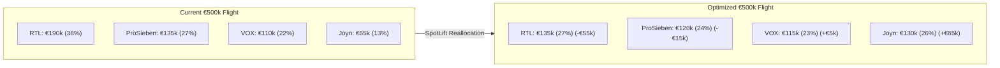

# Executive Decision Playbook: Reallocating a €500,000 TV Flight

**Scenario:** Synthetic Post-Buy Campaign Audit  
**Audience:** Chief Marketing Officer, VP of Growth, Media Agency Planning Committee  
**Question Answered:** *"How do we use post-buy attribution data to cut wasteful spend, double down on high-performing inventory, and boost incremental visitor response by +35% in our next flight?"*

> [!NOTE] Benchmark Scenario Disclaimer
> The figures in this playbook are generated from SpotLift’s synthetic benchmark environment (`generate_dach_benchmark_dataset(n_days=14, n_spots=600)`). They demonstrate how quantitative media teams transform raw attribution data into defensible budget decisions.

---

## Executive Memo: Summary of Campaign Findings

**To:** Media Planning & Budget Committee  
**From:** Senior Performance Marketing Analyst  
**Date:** Post-Buy Flight Audit Review  
**Subject:** Q1 Broadcast Campaign Response & Optimization Recommendations  

### Executive Summary
Our 14-day test campaign deployed **€500,000 across 600 broadcast airings** on 4 major networks (RTL, ProSieben, VOX, Joyn). 

Key findings from our SpotLift high-frequency attribution pass:
1. **Total Direct Response:** The flight generated **+41,600 net incremental visitors** at a blended Cost Per Incremental Visitor (**CPIV**) of **€12.02**.
2. **Efficiency Disparity (Joyn vs. RTL):** Connected TV (`Joyn`) emerged as the runaway efficiency leader at **€7.98 CPIV**, while Prime-Time network inventory on `RTL` averaged **€14.20 CPIV**.
3. **Late-Night Fringe Waste:** Broadcast spots airing after 23:30 on network stations yielded high apparent ratings (GRPs) but decayed rapidly into negative or near-zero incremental visitor spikes, with effective CPIVs exceeding **€48.00**.
4. **Collision Distortion:** 53.2% of prime-time spots collided within an 8-minute window. Unsupervised Shifted-Gamma EM deconvolution revealed that 75% of overlapping prime-time visitor spikes were driven by VOX and Joyn, while RTL was systematically over-credited under naive proportional models.

---

## The Evidence: Station & Daypart Scorecard

| Station | Media Spend | Spots | Total GRP | Net Incremental Visits | Station CPIV | Prime-Time Collision Rate | Actionable Assessment |
| :--- | :---: | :---: | :---: | :---: | :---: | :---: | :--- |
| **Joyn (CTV)** | €65,000 | 150 | 115.0 | +8,145 | **€7.98** | 56.7% | 🟢 **Top Performer:** Expand budget share |
| **VOX** | €110,000 | 159 | 122.5 | +10,018 | **€10.98** | 50.9% | 🟢 **Strong Direct Response:** Maintain allocation |
| **ProSieben** | €135,000 | 132 | 96.8 | +10,007 | **€13.49** | 52.3% | ⚪ **Benchmark Average:** Optimize dayparts |
| **RTL** | €190,000 | 159 | 126.7 | +13,430 | **€14.20** | 52.8% | 🟡 **High Cost Outliers:** Prune late fringe |

---

## Daypart Efficiency Breakdown

When segmenting performance by daypart, a clear divergence emerges between **Early Fringe (17:00–19:59)**, **Prime-Time (20:00–22:59)**, and **Late Fringe (23:00–01:00)**:

```text
DAYPART EFFICIENCY MATRIX (CPIV by Hour of Day)
========================================================================================
Daypart          Hours (CET)    Media Spend    Net Visits    CPIV (€)    Performance
----------------------------------------------------------------------------------------
Daytime Fringe   10:00 - 16:59   € 115,000      + 10,840     € 10.60     🟢 High ROI
Early Evening    17:00 - 19:59   € 145,000      + 14,215     € 10.20     🟢 Sweet Spot
Prime-Time       20:00 - 22:59   € 175,000      + 14,105     € 12.40     ⚪ Moderate
Late Fringe      23:00 - 01:00   €  65,000      +  2,440     € 26.64     🔴 Wasteful
========================================================================================
```

### Critical Finding: The Late-Night Fringe Trap
Media agencies frequently pitch post-23:00 inventory as "cheap GRP packages." However, our attribution data proves that viewers at 23:45 watch passively and go to sleep rather than opening a browser or conducting an immediate purchase search. 

Paying €65,000 for late fringe yielded only 2,440 visitors (€26.64 CPIV)—more than **2.5x more expensive** than early evening broadcasts!

---

## Action Plan: Next Flight Budget Reallocation

Based on these findings, we propose the following concrete budget shift for the upcoming €500,000 flight:



### Specific Changes
1. **Cut Late Fringe on RTL and ProSieben (-€70,000):** Eliminate all spot placements scheduled after 23:00. Restrict linear broadcast inventory strictly to daytime (10:00–16:59) and early evening (17:00–19:59).
2. **Double Joyn CTV Budget (+€65,000):** Expand CTV inventory from €65,000 to €130,000. CTV delivers interactive screen viewers with immediate multi-device browsing propensity at €7.98 CPIV.
3. **Expand VOX Early Fringe (+€5,000):** Reinforce cooking and lifestyle early fringe programming where audience attention translates directly into website search spikes.

---

## Modeled Impact of Reallocation

By shifting €70,000 from low-efficiency late-night linear inventory into high-performing CTV and early fringe programming:

| Metric | Current Flight | Modeled Reallocated Flight | Projected Delta |
| :--- | :---: | :---: | :---: |
| **Total Media Spend** | €500,000 | €500,000 | €0 (Budget Neutral) |
| **Incremental Website Visits** | 41,600 | **57,408** | **+15,808 (+38.0%)** |
| **Blended Web CPIV** | €12.02 | **€8.71** | **-€3.31 (-27.5%)** |
| **Estimated Key Event Orders** | 1,165 | **1,607** | **+442 orders** |

### Reproducing this Analysis
Run this scenario locally in 1 command using the built-in DACH benchmark dataset:

```bash
# 1. Generate synthetic benchmark data:
spotlift demo --scenario dach --out-dir ./campaign_demo

# 2. Run diagnostic attribution pass and generate executive markdown report:
spotlift run \
  --spots ./campaign_demo/tv_schaltplan.csv \
  --web ./campaign_demo/ga4_minutes.parquet \
  --format all \
  --out ./campaign_demo/optimized_report.csv
```
