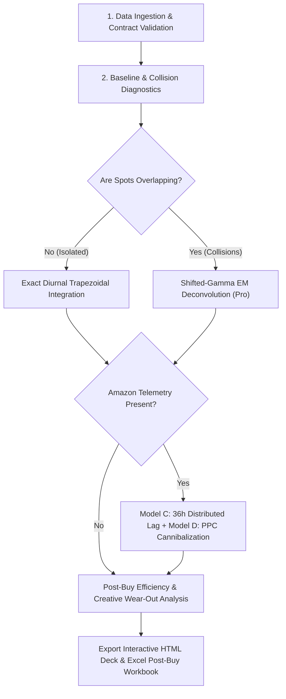

# SpotLift: Agentic TV & CTV Attribution Skill

This skill equips an AI coding or data agent with the domain knowledge, mathematical workflows, and commands required to execute econometric broadcast TV and Connected TV (CTV) lift attribution.

---

## 1. Core Principles & Data Source Reality

### A. Telemetry Granularity & Data Realism
* **Web Telemetry (GA4):** Must be **1-minute UTC grain** filtered strictly for **Direct & Organic** traffic. Paid search and paid social campaigns (Meta, Google Ads, TikTok) must be filtered out to isolate immediate broadcast impulses. Generate standard partition-pruned BigQuery SQL using:
  ```bash
  spotlift sql --source ga4 --project <GCP_PROJECT> --dataset <DATASET_ID>
  ```
* **Amazon Demand Telemetry:** 
  > [!IMPORTANT]
  > **Amazon Vendor Central and Seller Central portals NEVER provide data at minute grain.** Their native reporting is daily or weekly. The **only** enterprise mechanism to collect sub-daily (hourly) Amazon conversion and PPC telemetry is via **Amazon Marketing Cloud (AMC)** SQL clean rooms (`amazon_attributed_events_by_traffic_time` and `sponsored_ads_traffic`).
  * Generate standard ANSI Presto/Spark AMC telemetry extraction queries using:
    ```bash
    spotlift sql --source amc --start 2026-03-01 --end 2026-03-21
    ```
  * Hourly metrics collected: `amz_ordered_units`, `amz_ordered_gmv`, `amz_sponsored_brand_clicks`, `amz_sponsored_brand_spend`.

### B. Unbiased Signed Lift (`clip_negative: bool = False`)
* **Never censor negative lift by default.** Per-minute clipping $\max(0, Y_t - \hat{Y}_t)$ introduces severe upward bias ($\mathbb{E}[\max(0, \epsilon)] = \frac{\sigma}{\sqrt{2\pi}} \approx 0.4\sigma$) via Jensen's inequality, transforming zero-mean Gaussian background noise into strictly positive phantom lift.
* Always preserve signed residuals $\sum (Y_t - \hat{Y}_t)$ so noise fluctuations cancel out symmetrically across stations, dayparts, and creatives.

---

## 2. Standard Agent Workflow



### Step 1: Ingest & Validate Data Contracts
Always validate user CSV, Parquet, or DataFrames using SpotLift's Pydantic v2 schemas:
```python
import spotlift as sl

# Load and enforce UTC timezone normalization
airings_df = sl.load_airings("tv_schaltplan.csv")
ga4_df = sl.load_telemetry("ga4_minutes.parquet")
amz_df = sl.load_telemetry("amc_hourly.csv") if has_amazon else None
```

### Step 2: Open-Core Diurnal Attribution & Diagnostics
For quick checks and isolated spot analysis:
```python
core_results = sl.analyze_spots(
    airings=airings_df,
    web_telemetry=ga4_df,
    window_minutes=8,
    pre_window_minutes=15,
    baseline_days=21,
    clip_negative=False,  # Unbiased signed lift
)
```
* **Isolated Spots:** Receive exact signed trapezoidal lift `single_spot_diurnal_exact`.
* **Overlapping Spots:** Detected via graph clustering and assigned `naive_proportional_fallback`. A rich terminal diagnostic banner reports the collision percentage and identifies candidate prime-time clusters requiring Pro EM deconvolution.

### Step 3: Full Omnichannel Pro Attribution
When `spotlift_pro` is installed and an API key is available:
```python
results = sl.analyze_omnichannel_pro(
    airings=airings_df,
    web_telemetry=ga4_df,
    amazon_telemetry=amz_df,
    api_key="SL_PRO_...",
    window_minutes=8,
    amazon_lag_hours=36,
    export_html="postbuy_audit.html",
    export_excel="postbuy_audit.xlsx",
    white_label_config={"agency_name": "Media Agency", "primary_color_hex": "#2563eb"},
    clip_negative=False,
)
```

---

## 3. Interpreting Output Metrics

| Metric | Column Name | Interpretation & Guidance |
| :--- | :--- | :--- |
| **Incremental Lift** | `incremental_lift` | Signed visitor surge above calibrated baseline during treatment window $[t_k, t_k + 8\text{m}]$. Can be negative if local noise dipped below baseline; cancels out when aggregated. |
| **Cost Per Incremental Visitor** | `cpiv` | $\frac{\text{Net Spend}}{\text{Incremental Lift}}$. Only defined when lift $> 0$; returns `NaN` when lift $\le 0$. |
| **Amazon Incremental Orders** | `amz_incremental_units` | Attributed units deconvolved from 36-hour distributed lag transfer function. |
| **True Omnichannel ROAS** | `true_omnichannel_roas` | $\frac{\text{Web Direct Value} + \text{Amazon Halo GMV} - \text{PPC Cannibalization Tax}}{\text{TV Media Spend}}$. |
| **Creative Fatigue Half-Life** | `half_life_n50` | Airing count at which creative efficiency drops to 50% of launch value, controlling for daypart fixed effects. |

---

## 4. CLI Cheat Sheet for Agents

```bash
# 1. Generate standard GA4 BigQuery extraction query
spotlift sql --source ga4 --project my-gcp-project --dataset analytics_12345 --out ./ga4_extract.sql

# 2. Generate standard Amazon AMC hourly extraction query
spotlift sql --source amc --start 2026-03-01 --end 2026-03-21 --out ./amc_extract.sql

# 3. Create synthetic benchmark dataset for offline testing
spotlift demo --out-dir ./demo_data --days 14 --spots 600

# 4. Run Open-Core attribution from command line
spotlift run --spots schaltplan.csv --web ga4_minutes.parquet --out results.csv

# 5. Run full Pro Omnichannel attribution and generate deck
spotlift run --spots schaltplan.csv --web ga4_minutes.parquet --amazon amc_hourly.csv --key SL_PRO_... --out results.csv --html audit.html --excel audit.xlsx
```
